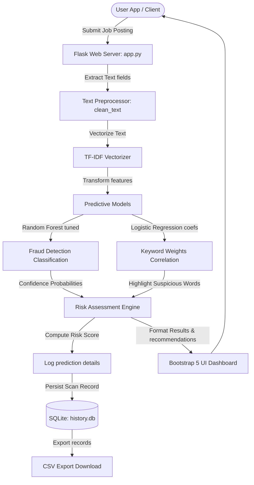
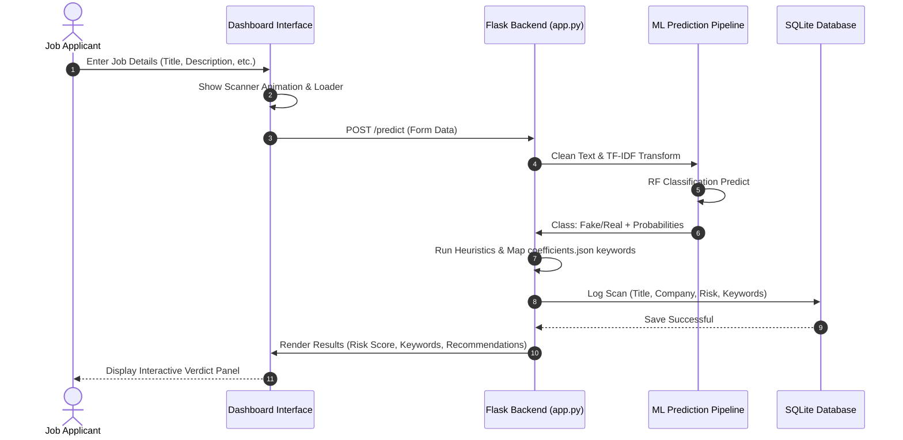

# VeriWork AI - Fake Job Posting Detection System

VeriWork AI is an internship-grade, end-to-end Machine Learning web application designed to analyze online job postings and identify fraudulent listings in real-time. Built with a Flask backend, SQLite data logging, and a responsive Bootstrap 5 dashboard (with Light/Dark theme support), the system leverages a tuned Random Forest classifier with TF-IDF text features to calculate safety confidence scores, assess risks, highlight suspicious keywords, and offer protective recommendations to applicants.

---

## 🛠️ System Architecture

The following diagram illustrates the data flow and system structure:



---

## 📊 User Interaction Flow



---

## ✨ Features

- **Tuned Machine Learning Engine**: An ensemble Random Forest model optimized with hyperparameter tuning, class-weight balancing (to resolve the 4.8% fraud class imbalance), and stratified cross-validation.
- **Explainable AI Predictor**: Calculates an interactive 0-100% fraud risk score based on both probability outputs and custom logical heuristics (e.g. empty company profiles).
- **Dynamic Keyword Highlight**: Maps input listing words against Logistic Regression feature coefficients in `coefficients.json` to highlight scam-correlated terms (like *cash*, *deposit*, *earn*, *wire*).
- **User Action Recommendations**: Displays actionable instructions for the applicant depending on the risk tier (Low, Medium, or High Risk).
- **SQLite History Log**: Captures every scan in a persistent SQLite database, listing timestamps, titles, risk levels, and predictions.
- **CSV Data Export**: Enables quick export of all scanned job logs into a standard CSV file directly from the UI.
- **REST API Routes**: Open endpoints (`/api/predict` and `/api/history`) for programmatic integration.
- **Light & Dark Mode Dashboard**: Clean, modern dashboard built with Bootstrap 5, custom gradients, CSS variables, and persistent LocalStorage theme preferences.

---

## 📂 Project Structure

```text
fake-job-detection/
│
├── app.py                      # Flask web server, routes, database logs, and predictions
├── requirements.txt            # Python environment dependencies
├── history.db                  # SQLite database holding prediction logs (auto-generated)
│
├── dataset/
│   └── fake_job_postings.csv   # Kaggle dataset (17,880 listings)
│
├── model/
│   ├── fake_job_model.pkl      # Saved Random Forest model
│   ├── tfidf_vectorizer.pkl    # Saved TF-IDF vectorizer
│   └── coefficients.json       # Feature-word correlation weights
│
├── notebook/
│   └── FakeJobDetection.ipynb  # Explanatory Jupyter Notebook used for initial training
│
├── scratch/
│   ├── train_model.py          # Tuning, training, and plot asset generation script
│   └── evaluate_models.py      # Baseline evaluation comparison script
│
├── templates/
│   ├── index.html              # Main Bootstrap 5 dashboard
│   ├── analytics.html          # Performance charts and curves display page
│   └── error.html              # Custom 404/500 template page
│
└── static/
    └── assets/                 # Auto-generated model validation plots (ROC, PR, Confusion Matrix)
```

---

## ⚙️ Installation & Setup Guide

### 1. Prerequisites
- Python 3.8 or higher installed on your system.
- Git (optional, for cloning).

### 2. Setup Virtual Environment
Open terminal in the project directory:
```powershell
# Create virtual environment
python -m venv venv

# Activate virtual environment
# On Windows (PowerShell):
.\venv\Scripts\Activate.ps1
# On macOS/Linux:
source venv/bin/activate
```

### 3. Install Dependencies
```powershell
pip install -r requirements.txt
```

### 4. Run Model Training & Plot Asset Generation (Optional)
If you want to retrain the optimized Random Forest classifier and refresh the evaluation graphs (ROC, PR curve, Confusion Matrix, feature comparison) inside `static/assets/`, run:
```powershell
python scratch/train_model.py
```

### 5. Launch the Application
```powershell
python app.py
```
Open your browser and navigate to `http://127.0.0.1:5000/`.

---

## 📡 REST API Documentation

### 1. Run Predictions
- **Endpoint**: `/api/predict`
- **Method**: `POST`
- **Headers**: `Content-Type: application/json`
- **Request Body JSON Example**:
```json
{
  "title": "Remote Data Entry Clerk",
  "company_profile": "",
  "description": "We are looking for immediate data entry assistants. Earn $500/day. No experience needed. Send training deposit.",
  "requirements": "Internet access, typing speed.",
  "benefits": "High daily pay, bonuses, work from anywhere."
}
```
- **Response JSON Example**:
```json
{
  "status": "success",
  "prediction": "Fake",
  "prediction_code": 1,
  "confidence": 76.5,
  "risk_score": 91,
  "risk_level": "High Risk",
  "suspicious_keywords": ["deposit", "earn", "cash", "entry"],
  "flags_triggered": [
    "Missing or extremely short company profile.",
    "High density of high-risk keywords detected."
  ],
  "recommendations": [
    "Do NOT pay any upfront registration, training, or material fees.",
    "Verify the company profile independently on LinkedIn, Google, or Glassdoor.",
    "Check if the email domain matches the official company website."
  ]
}
```

### 2. Fetch Prediction Logs
- **Endpoint**: `/api/history`
- **Method**: `GET`
- **Response JSON Example**:
```json
{
  "status": "success",
  "history": [
    {
      "id": 1,
      "title": "Remote Data Entry Clerk",
      "company": "",
      "prediction": "Fake",
      "confidence": 76.5,
      "risk_score": 91,
      "timestamp": "2026-08-01 15:30:10"
    }
  ]
}
```
